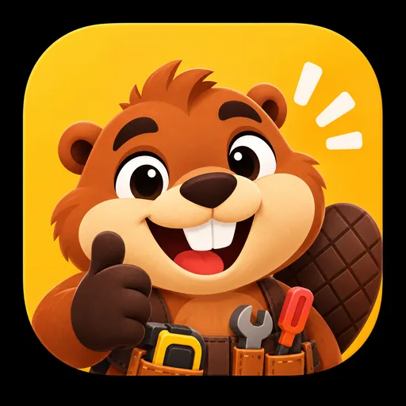

<div align="center">


# OficioYa · Frontend

**El talento de tu zona a un click de distancia.**

Directorio inteligente y reputación digital para el trabajo informal en Colombia.
Aquí vive todo lo que la gente ve y toca: la web de OficioYa hecha con React, TypeScript y Vite.


</div>

---

## Tabla de contenido

1. [¿Qué es OficioYa y para quién es?](#1-qué-es-oficioya-y-para-quién-es)
2. [Cómo correr el proyecto en 2 minutos](#2-cómo-correr-el-proyecto-en-2-minutos)
3. [La idea detrás del diseño](#3-la-idea-detrás-del-diseño)
   - [El manual de identidad, en resumen](#el-manual-de-identidad-en-resumen)
4. [Colores: la paleta y por qué cada uno está donde está](#4-colores-la-paleta-y-por-qué-cada-uno-está-donde-está)
5. [Modo claro y modo oscuro](#5-modo-claro-y-modo-oscuro)
6. [Liquid Glass: el material de la interfaz](#6-liquid-glass-el-material-de-la-interfaz)
7. [Tipografía](#7-tipografía)
8. [Forma, espacio y distribución de las pantallas](#8-forma-espacio-y-distribución-de-las-pantallas)
9. [Many, la mascota](#9-many-la-mascota)
10. [El logo](#10-el-logo)
11. [Iconografía](#11-iconografía)
12. [Movimiento y animaciones](#12-movimiento-y-animaciones)
13. [Los dos roles: Contratante y Profesional](#13-los-dos-roles-contratante-y-profesional)
14. [Recorrido por las pantallas](#14-recorrido-por-las-pantallas)
15. [Catálogo de componentes](#15-catálogo-de-componentes)
16. [Accesibilidad](#16-accesibilidad)
17. [Arquitectura del código](#17-arquitectura-del-código)
18. [Datos simulados (Mock-First) y cómo conectar el backend](#18-datos-simulados-mock-first-y-cómo-conectar-el-backend)
19. [Rendimiento](#19-rendimiento)
20. [Despliegue en GitHub Pages](#20-despliegue-en-github-pages)
21. [Cómo contribuir sin romper la identidad](#21-cómo-contribuir-sin-romper-la-identidad)
22. [Créditos](#22-créditos)

---

## 1. ¿Qué es OficioYa y para quién es?

Cuando a alguien se le revienta un tubo a las diez de la noche, casi nunca sabe a quién llamar. Termina preguntando en el grupo de WhatsApp del conjunto o llamando al primer número pegado en un poste, sin saber si esa persona es de confianza, si cobra justo o si va a llegar.

Del otro lado está el plomero, la electricista o el cerrajero que trabaja por su cuenta, que es muy bueno en lo suyo pero vive del voz a voz y no tiene cómo demostrar su experiencia fuera de su barrio.

**OficioYa conecta a esas dos personas.** Es un directorio hiperlocal donde cada profesional tiene un perfil con su oficio, su tarifa, su zona, su disponibilidad en tiempo real y, sobre todo, una reputación construida con reseñas verificadas: solo puede calificar quien de verdad recibió el servicio.

No son dos aplicaciones separadas. Es un solo lugar con dos modos que se cambian con un toque:

| Modo | Quién es | La frase que lo resume |
| :--- | :--- | :--- |
| **Contratante** | La persona que tiene un problema en su casa o negocio | *"Tengo un problema y necesito resolverlo."* |
| **Profesional** | La persona que ofrece su oficio | *"Hay personas que necesitan lo que yo sé hacer."* |

### La ficha de identidad (según el manual)

| | |
| :--- | :--- |
| **Nombre** | Oficio Ya |
| **Tipo** | Directorio inteligente |
| **Enfoque** | Oficios técnicos y asistenciales |
| **El problema** | Boca a boca informal, directorios desactualizados y falta de garantías. |
| **La solución** | Profesionales verificados, evaluados y geolocalizados cerca. |
| **Dos caras** | Contratante y Profesional |

### Para quién diseñamos

El manual describe dos públicos muy concretos, y casi todas las decisiones de interfaz salen de pensar en ellos:

- **El contratante:** personas mayores de edad (hogares, estudiantes independientes, **adultos mayores** y comercios locales) que necesitan solucionar daños o mantenimientos **con inmediatez**, con **tarifas transparentes** y con la tranquilidad de contratar a vecinos calificados por su propia comunidad.
- **El trabajador independiente:** técnicos y personas de oficios prácticos **de 18 a 65 años** que quieren hacerse visibles en su zona, aprovechar sus tiempos libres y construir una **reputación digital verificable** sin depender del voz a voz.

Y la app tiene que servir en cuatro situaciones: **uso cotidiano, urgencias, proyectos programados y servicios recurrentes.**

Esto explica cosas que vas a ver en todo el código. Hay adultos mayores, así que la letra se puede agrandar, el contraste es AA y los objetivos táctiles son grandes. Hay urgencias, así que el buscador va primero y la disponibilidad se ve de un vistazo. Y como la tarifa transparente es una promesa, el precio siempre está en la tarjeta.

Este repositorio es el **frontend** (la SPA web). El backend en Spring Boot + PostgreSQL se construye en paralelo en el repositorio **OficioYa-Backend**, y por eso el frontend funciona hoy al 100 % con datos simulados (más en la [sección 18](#18-datos-simulados-mock-first-y-cómo-conectar-el-backend)).

---

## 2. Cómo correr el proyecto en 2 minutos

### Lo que necesitas

- **Node.js 20.19 o superior** (o 22.12 en adelante), que es lo que pide Vite 8. El despliegue usa Node 20.
- **npm** (viene con Node).
- Un navegador moderno. Chrome, Edge, Firefox y Safari recientes soportan el efecto de vidrio (`backdrop-filter`); en los que no, la app cae a superficies sólidas y sigue funcionando.

### Pasos

```bash
# 1. Clona el repo y entra a la rama de trabajo
git clone https://github.com/OficioYa1/OficioYa-Frontend.git
cd OficioYa-Frontend
git checkout develop

# 2. Instala dependencias (usa el lockfile, igual que en el deploy)
npm ci

# 3. Arranca el servidor de desarrollo
npm run dev
```

Vite te muestra una dirección parecida a `http://localhost:5173/oficioya-frontend/`. Fíjate en el `/oficioya-frontend/` del final: es la ruta base que usa GitHub Pages y la app la respeta también en local.

### Para entrar sin registrarte

En la pantalla de inicio de sesión hay un botón **"Usar cuenta demo"** que llena todo por ti:

| Campo | Valor |
| :--- | :--- |
| Correo | `juan.perez@correo.com` |
| Contraseña | `demo123` |

También puedes crear tu propia cuenta: se guarda en el `localStorage` de tu navegador.

### Scripts disponibles

| Comando | Qué hace |
| :--- | :--- |
| `npm run dev` | Servidor de desarrollo con recarga instantánea. |
| `npm run build` | Revisa los tipos con `tsc -b`, compila con Vite a `dist/` y copia `index.html` como `404.html` para que GitHub Pages no rompa al recargar una ruta. |
| `npm run preview` | Sirve la carpeta `dist/` para probar el build final antes de subirlo. |
| `npm run lint` | Corre [oxlint](https://oxc.rs/docs/guide/usage/linter.html), un linter muy rápido escrito en Rust. |

> **Consejo:** antes de abrir un PR corre `npm run build`. Si TypeScript se queja, el deploy también va a fallar.

---

## 3. La idea detrás del diseño

Antes de hablar de colores y componentes, vale la pena entender qué queremos que la gente sienta al abrir OficioYa.

### La personalidad: cercana, resolutiva y local

Así la define el manual, y es la mejor brújula para cualquier texto o pantalla nueva:

> *Habla claro. Celebra el oficio bien hecho. Inspira confianza sin ser rígida y acompaña sin invadir.*

Y su filosofía:

> ***La reputación se construye haciendo.*** *Cada encuentro útil fortalece una red local donde el talento visible genera nuevas oportunidades.*

En la interfaz eso se traduce en mensajes cortos y directos ("¡Todo al día!", "Acuerda la tarifa antes del servicio"), en celebrar los trabajos terminados y las buenas reseñas, y en un Many que aparece cuando ayuda y se aparta cuando estorba.

### El eslogan, palabra por palabra

> **El talento de tu zona a un click de distancia.**

| Parte | Lo que hace (manual) | Cómo se ve en la app |
| :--- | :--- | :--- |
| **Talento** | Reconoce el saber hacer. | Perfiles con portafolio, reputación por oficio y la insignia *Verificado*. |
| **Tu zona** | Activa la cercanía local. | Distancia en cada tarjeta, orden por cercanía, chip de ciudad en el header. |
| **A un click** | Simplifica el acceso. | Buscador como primer elemento, solicitud directa desde el perfil, chat integrado. |

### Lo que sí somos

- **Cercanos y humanos.** Detrás de cada tarjeta hay una persona con nombre, cara y barrio.
- **Prácticos y rápidos.** Quien busca un plomero está apurado; la interfaz no le puede hacer perder tiempo.
- **Confiables y locales.** La reputación y la distancia se ven siempre, sin tener que buscarlas.
- **Modernos y accesibles.** Se ve actual, pero lo usa igual de bien un estudiante que alguien que no se lleva con la tecnología.

### Lo que no somos

- Una plataforma corporativa fría ni un "dashboard" empresarial lleno de gráficas.
- Un marketplace genérico de productos.
- Una app robótica o saturada.

### Qué evitar (las cuatro reglas del manual)

1. **Promesas vacías.** No afirmar garantías que la experiencia no puede sostener. Por eso la app habla de reseñas verificadas e identidad validada, que son cosas que de verdad comprueba, en lugar de prometer resultados.
2. **Tono impersonal.** No sonar frío, burocrático ni distante. Por eso los avisos de la app están escritos en tono cercano y nunca muestran códigos internos.
3. **Saturación visual.** No mezclar colores, estilos o mensajes sin jerarquía. Por eso existe un solo color principal por rol y una sola acción principal por pantalla.
4. **Estereotipos.** No reducir los oficios a caricaturas ni clichés. Many puede ser tierno, pero los profesionales siempre aparecen como personas: con su nombre, su foto, su oficio y su trabajo.

### El principio central

> **Una red local que conecta a quienes necesitan resolver algo con quienes saben cómo hacerlo.**
> *Las personas y sus oficios son siempre el centro.*

### Los tres pilares visuales

1. **El manual de identidad manda.** Todos los colores, el logo y Many salen del *Manual de identidad Oficio Ya v1.0*. Cuando una referencia externa choca con el manual, gana el manual. Esta regla se tomó de forma explícita durante el rediseño y está escrita en el código (`src/styles/tokens.css`).
2. **Liquid Glass.** La interfaz está hecha de paneles de vidrio esmerilado que flotan sobre un fondo líquido con los colores de la marca. Da profundidad y modernidad sin perder calidez.
3. **Editorial, no recargado.** Mucho aire, titulares grandes y ligeros, y un solo gesto fuerte de color por pantalla.

### El manual de identidad, en resumen

El *Manual de identidad de marca Oficio Ya, versión 1.0*, es la fuente de verdad de todo lo visual. Si vas a tocar algo de marca, ábrelo primero. Estas son sus páginas y dónde se aplican en este README:

| Página del manual | Tema | Dónde se aplica |
| :--- | :--- | :--- |
| 01 · Fundamentos | Identidad de Oficio Ya | [Sección 1](#1-qué-es-oficioya-y-para-quién-es) |
| 02 · Audiencias | Público objetivo | [Sección 1](#para-quién-diseñamos) |
| 03 · Voz | Personalidad y filosofía | [Sección 3](#la-personalidad-cercana-resolutiva-y-local) |
| 04 · Mensaje | Eslogan oficial | [Sección 3](#el-eslogan-palabra-por-palabra) |
| 05 · Mascota | Many | [Sección 9](#9-many-la-mascota) |
| 06 · Identificador | El logo | [Sección 10](#10-el-logo) |
| 07 · Consistencia | Zona de seguridad y usos incorrectos | [Sección 10](#10-el-logo) |
| 08 · Sistema | Paleta de color | [Sección 4](#4-colores-la-paleta-y-por-qué-cada-uno-está-donde-está) |
| 09 · Tipografía | DM Sans e Inter | [Sección 7](#7-tipografía) |
| 10 · Lenguaje visual | Etiquetas, tarjetas, estados y marcos | [Sección 8](#los-elementos-visuales-del-manual) |
| 11 · Interfaz | Iconografía | [Sección 11](#11-iconografía) |
| 13 · Criterio | Qué evitar | [Sección 3](#qué-evitar-las-cuatro-reglas-del-manual) |
| 14 · Principio central | La red local | [Sección 3](#el-principio-central) |


#### Lo que la app hereda del propio diseño del manual

El manual no solo dice qué colores usar; su propia maqueta ya es un sistema, y la app sigue la misma lógica:

- **Fondo Azul Marino con un degradado suave.** Por eso las bandas de héroe de la app son paneles líquidos Azul Marino, y el modo oscuro es azul noche y no negro.
- **Una etiqueta pequeña en mayúsculas, espaciada y en ámbar encima de cada título** ("01 · FUNDAMENTOS"). En la app es la clase `.oy-eyebrow`.
- **Títulos grandes en DM Sans** con una barra corta amarilla debajo. En la app, los titulares grandes también van en DM Sans con la clase `.oy-display`.
- **Tarjetas blancas limpias sobre el azul**, que en la app se volvieron vidrio claro sobre el fondo líquido.
- **Many acompañando cada página** en una pose distinta, pero nunca tapando el contenido.

### Inspiraciones (y lo que tomamos de cada una)

| Referente | Qué tomamos | Qué no tomamos |
| :--- | :--- | :--- |
| **Duolingo** | La idea de una mascota como centro del reconocimiento de marca, con personalidad propia. | Nada de su paleta ni de su estilo gráfico. OficioYa no tiene relación alguna con Duolingo Inc. |
| **LinkedIn** | Perfiles con experiencia, habilidades validadas y la reputación como activo principal. | El tono corporativo. |
| **inDrive** | La lógica de proximidad, el servicio bajo demanda y la conexión directa sin intermediarios. | Su interfaz. |
| **Slush** (referencia de estilo) | Formas muy redondeadas, botones en píldora, tipografía display, ritmo de secciones. | Su paleta, su negro y sus cintas 3D azules. |
| **monopo saigon** | La calma editorial, titulares enormes de peso ligero y movimiento lento y suave. | La paleta en blanco y negro y las esquinas en 0 px. |

---

## 4. Colores: la paleta y por qué cada uno está donde está

### Los 8 colores oficiales

Estos son los colores del manual de identidad (página 08 · Sistema). En el código viven como **primitivos** (`--oy-*`) en `src/styles/tokens.css` y nunca se modifican.


| Muestra | Nombre | HEX | Lo que significa | Dónde lo vas a ver |
| :---: | :--- | :--- | :--- | :--- |
|  | **Amarillo Canario** | `#FFC72C` | Energía | El "Ya" del logo, la insignia *Verificado*, el CTA de energía, la selección de texto y el foco en modo oscuro. |
|  | **Ámbar Cálido** | `#F59E0B` | Acento | Las estrellas de calificación y los brillos del fondo líquido. |
|  | **Verde Esmeralda** | `#10B981` | Estado | Solo para **"Disponible ahora"** y estados positivos. |
|  | **Naranja fuerte y cálido** (en el código, *Naranja Many*) | `#C9622A` | Many | El pelaje de Many y acentos que lo acompañan. |
|  | **Azul Marino Clásico** | `#1E3A8A` | Confianza | Color del **rol Contratante**: botones principales, navegación activa, bandas de héroe, anillo de foco. |
|  | **Naranja Fuego** | `#EA580C` | Acción | Color del **rol Profesional**: iconos, bordes, textos grandes. |
|  | **Cacao Profundo** | `#3E1F14` | Detalle | El color del texto principal y de las líneas finas. Reemplaza al negro. |
|  | **Almendra Claro** | `#F8D8A8` | Calidez | La base del lienzo claro, lavados suaves y fondos cálidos. |

### Por qué estos colores y no otros

- **Azul Marino para confiar.** Es el color que la gente asocia con bancos, seguros y salud: cosas en las que uno confía. Cuando vas a dejar entrar a alguien a tu casa, necesitas esa sensación. Por eso el Contratante, que es quien está tomando el riesgo, vive en azul.
- **Naranja Fuego para trabajar.** El naranja es el color de la herramienta, del casco y de la señal de obra. Transmite movimiento y acción. Cuando alguien cambia a modo Profesional, la app entera se pinta de naranja para que su cabeza también cambie a "estoy trabajando".
- **Verde Esmeralda solo para "disponible".** Si el verde estuviera en todas partes, perdería su significado. Lo guardamos para la pregunta más urgente del contratante: *¿esta persona puede venir ya?*
- **Amarillo Canario para la energía de la marca.** Es el "Ya" del nombre: la rapidez. Se usa en pequeñas dosis porque grita mucho.
- **Cacao en vez de negro.** La paleta del manual no incluye negro (solo aparece en una versión monocromática del wordmark para impresión). En la interfaz, el Cacao cumple el papel del negro (texto y contornos) y mantiene la calidez de la marca. Además es el color de la cola y la nariz de Many, así que el texto "habla" el mismo idioma que la mascota.
- **Almendra de fondo en vez de blanco puro.** El blanco absoluto cansa y se siente clínico. Un lienzo almendra muy diluido (`#FBF4EA`) se siente como papel, más cálido y más humano.

### Tonos derivados para accesibilidad

Algunos colores del manual no alcanzan el contraste mínimo WCAG AA (4,5:1) cuando llevan texto encima. En vez de cambiar la marca, creamos **tonos hermanos más oscuros** que solo se usan cuando hay texto:

| Token | HEX | Para qué | Contraste |
| :--- | :--- | :--- | :--- |
| `--oy-naranja-fuego-aa` | `#C2410C` | Fondo de botones del Profesional con texto blanco | 5,18:1 (el `#EA580C` original da 3,56:1) |
| `--oy-ambar-aa` | `#B45309` | Texto ámbar sobre blanco | 5,02:1 |
| `--oy-esmeralda-aa` | `#047857` | Texto verde sobre blanco | 5,48:1 |

Además hay dos reglas que nunca se rompen:

- **Nunca texto amarillo sobre fondo claro** (da 1,3:1, ilegible). El amarillo va de fondo con texto Cacao encima (9,54:1).
- **"Disponible" va en verde con texto Cacao** (5,87:1). En el manual el círculo de *Disponible* lleva texto blanco, que se ve bien en una presentación grande pero en pantalla da 2,54:1 y no pasa AA. Mantuvimos el verde exacto del manual y solo cambiamos el color del texto.

### Neutros y el rojo

- **Neutros** (`--oy-superficie`, `--oy-carbon`, `--oy-gris-*`): vienen del documento técnico y son compatibles con el manual. Se usan con moderación.
- **Rojo** (`--oy-rojo: #DC2626`): el manual no define rojo. Lo reservamos **solo** para errores y acciones destructivas (eliminar, cancelar, reportar). Nunca como decoración.

### Las tres capas de color en el código

```text
Primitivos   (--oy-*)       →  los 8 colores del manual, intocables
     ↓
Semánticos   (--color-*)    →  para qué se usa cada color: trust, action, status, energy…
     ↓
Del rol      (--role-*)     →  cambian según seas Contratante o Profesional
```

La regla de oro: **los componentes solo usan tokens semánticos o de rol, nunca un HEX suelto.** Si un componente necesita un color que no existe, la primera pregunta es si el manual lo permite.

Algunos semánticos que vas a usar a diario:

| Token | Apunta a | Uso |
| :--- | :--- | :--- |
| `--color-trust` | Azul Marino | Confianza, enlaces, elementos del contratante |
| `--color-action` / `--color-action-strong` | Naranja Fuego / Fuego AA | Iconos y bordes / fondo de botones con texto |
| `--color-status` / `--color-on-status` | Esmeralda / Cacao | Insignia "Disponible" |
| `--color-energy` / `--color-on-energy` | Amarillo / Cacao | Insignia "Verificado", CTA de energía |
| `--color-star` | Ámbar | Estrellas de reseñas |
| `--color-error` | Rojo | Errores y acciones destructivas |
| `--color-focus-ring` | Azul Marino (claro) / Amarillo (oscuro) | Anillo de foco del teclado |
| `--role-primary` | Marino o Fuego AA según el rol | El color principal de cada pantalla |

---

## 5. Modo claro y modo oscuro

La app tiene los dos modos, se cambia desde el menú de cuenta y la elección se recuerda. Por dentro, el tema es una clase en `<html>`: `theme-light` o `theme-dark`.

| | Modo claro | Modo oscuro |
| :--- | :--- | :--- |
| **Lienzo** | Almendra muy diluido `#FBF4EA` | Azul noche `#0B1430` (Azul Marino profundo) |
| **Texto principal** | Cacao `#3E1F14` (14,9:1) | Crema `#F8F1E6` (15,6:1) |
| **Texto secundario** | `#5B4636` (8,2:1) | `#D3C5B3` (10,4:1) |
| **Vidrio** | Blanco translúcido | Marino translúcido |
| **Foco del teclado** | Azul Marino | Amarillo Canario |
| **Contratante** | `#1E3A8A` | Se aclara a `#7B96E3` para que se lea |

**¿Por qué el modo oscuro es azul y no negro?** Porque así sigue siendo OficioYa. Un fondo negro genérico haría que la app pareciera cualquier otra; un Azul Marino muy profundo conserva la identidad y es más amable con los ojos de noche.

Los colores del manual **no cambian** en modo oscuro. Solo se aclaran los que serían ilegibles sobre fondo oscuro (el Azul Marino y los textos AA).

El navegador también sabe del tema: `index.html` declara `theme-color` `#FBF4EA` en claro y `#0B1430` en oscuro, para que la barra del celular combine con la app.


---

## 6. Liquid Glass: el material de la interfaz

El rediseño actual se llama **Liquid Glass**. La idea es sencilla: la interfaz está hecha de **vidrio esmerilado** que flota en capas sobre un **fondo líquido** que se mueve muy despacio.

### Por qué vidrio

- **Da profundidad sin sombras pesadas.** Se entiende de inmediato qué está encima de qué (un modal sobre una tarjeta sobre el fondo).
- **Deja ver la marca sin taparla.** Los colores del fondo se asoman a través del vidrio, así que la identidad está presente en toda la app sin pintar cada superficie de un color fuerte.
- **Se siente moderno y premium**, que era lo que se buscaba en el rediseño: profesional, limpio y suave.

### Las tres capas de profundidad

```text
Capa 3 · Vidrio elevado   (--glass-3, 88 %)  →  modales
Capa 2 · Vidrio de barra  (--glass-2, 72 %)  →  header, menús, barra inferior, toasts
Capa 1 · Vidrio de tarjeta(--glass-1, 52 %)  →  tarjetas, chips, paneles
Capa 0 · Fondo líquido                        →  manchas de color difuminadas
```

Entre más arriba está una capa, más opaca es y más profunda es su sombra (`--depth-1`, `--depth-2`, `--depth-3`). Las sombras no son negras: están teñidas de Azul Marino y Cacao, así que se sienten parte de la marca.

### El canto de luz

Cada panel de vidrio tiene un **borde de luz** arriba (`--glass-edge`) y una línea muy tenue abajo (`--glass-line`). Es el reflejo que hace que el ojo lea "esto es vidrio" y no "esto es un rectángulo blanco transparente".

### El fondo líquido

`src/components/background/LiquidBackground.tsx` dibuja cuatro manchas enormes y muy difuminadas con los colores del manual:

- **A:** Azul Marino
- **B:** Ámbar Cálido
- **C:** Amarillo Canario
- **D:** Verde Esmeralda

Se desplazan muy lento (entre 32 y 44 segundos por ciclo), con una capa de grano encima para que no se vea digital. Es **solo CSS**, así que no frena el arranque, y se queda quieto si el usuario pidió reducir el movimiento.

En el llamado final de la landing hay además un fondo en shader (**PlasmaWarp**, con WebGL a través de `ogl`) que se carga aparte, solo cuando hace falta.

### Reglas del vidrio

- El vidrio solo va donde el texto sigue cumpliendo **AA en el peor punto** del fondo.
- **Máximo 3 capas** de vidrio apiladas a la vista y un desenfoque de 22 px (`--glass-blur`), para no castigar celulares de gama baja.
- Si el navegador **no soporta `backdrop-filter`**, el vidrio se vuelve sólido (`@supports not`).
- Si el usuario activó **reducir transparencia** en su sistema, el vidrio se vuelve opaco (`prefers-reduced-transparency`).


---

## 7. Tipografía

El manual define dos familias y no usamos ninguna otra. Se cargan desde Google Fonts en `index.html`.

| Familia | Rol | Por qué |
| :--- | :--- | :--- |
| **DM Sans** | Títulos, mensajes clave, cifras (tarifa, distancia, calificación) | Es geométrica y amable. Tiene personalidad sin ser infantil, y en pesos ligeros a gran tamaño se ve editorial. |
| **Inter** | Texto, formularios, botones, navegación, datos | Fue diseñada para pantallas. Se lee perfecto en tamaños pequeños y en celulares, y es neutra para que el protagonista sea el contenido. |

```css
--font-display: 'DM Sans', 'Inter', system-ui, sans-serif;
--font-text:    'Inter', system-ui, -apple-system, sans-serif;
```

### Escala

El manual (página 09, *"Una voz clara y contemporánea"*) fija **título principal 58, subtítulo 34 y texto corrido 24**, y pide un texto *"legible, directo y humano"*. Esos tamaños están pensados para la presentación del manual. En la app, los títulos usan la misma proporción pero con `clamp()`, para que crezcan con la ventana sin desbordarse en un celular de 360 px, y el texto corrido baja a 16 px, que es el tamaño cómodo de lectura en pantalla.


| Token | Tamaño | Uso |
| :--- | :--- | :--- |
| `--text-display` | 40 → 58 px | Titulares de héroe |
| `--text-h1` | 28 → 34 px | Título de página |
| `--text-h2` | 20 → 24 px | Título de sección |
| `--text-h3` | 20 px | Nombre del profesional en tarjetas |
| `--text-data` | 17 px | Tarifa, km, calificación (DM Sans en negrita) |
| `--text-body` | 16 px | Texto normal |
| `--text-small` | 14 px | Texto secundario, inputs |
| `--text-caption` | 12 px | Insignias, metadatos |

### El estilo editorial

La clase `.oy-display` es el sello del rediseño: **titulares grandes y ligeros** (peso 400, interlineado 0,95, interletra −0,045em). Va en contra de la costumbre de poner los títulos en negrita, y justamente por eso se siente calmado y premium.

Las etiquetas en mayúsculas (eyebrows, chips) usan Inter en negrita con un poco de aire entre letras (`--tracking-label`), para que respiren dentro de las píldoras.

### Jerarquía al leer un perfil

Los pesos están pensados para que el ojo escanee en este orden:

> **Foto → Nombre → Oficio → Reputación → Distancia → Precio → Disponibilidad**

Nombre y precio pesan más; el oficio va más ligero. Así alguien con prisa encuentra lo que necesita sin leer todo.

Además, desde Configuración se puede **agrandar la letra** (normal, grande y extra grande), pensando en quienes leen con dificultad en el celular.

---

## 8. Forma, espacio y distribución de las pantallas

### Los elementos visuales del manual

La página 10 del manual (*Lenguaje visual*) define cuatro piezas básicas, y cada una tiene su equivalente directo en la app:

| Elemento del manual | Cómo es en el manual | Cómo vive en la app |
| :--- | :--- | :--- |
| **Etiquetas** | Píldora Amarillo Canario con texto oscuro en mayúsculas: *PROFESIONAL VERIFICADO* | `Badge` de *Verificado* (amarillo con texto Cacao) y todos los chips en píldora |
| **Tarjetas** | Rectángulo blanco limpio | `.card` de vidrio claro |
| **Estados** | Círculo Verde Esmeralda: *DISPONIBLE* | `Badge` de *Disponible* con punto verde |
| **Marcos** | Rectángulo de esquinas redondeadas para ilustración o foto | Marcos de foto en perfiles, portafolio y `ProfileCard` |

El manual también deja espacio para **"Many interactuando con componentes"**: la mascota puede asomarse junto a una tarjeta o una etiqueta, que es justo lo que hace `MascotAssistant`.


### Radios: todo redondeado

| Elemento | Radio | Por qué |
| :--- | :--- | :--- |
| Botones, chips, pestañas, nav | `999px` (píldora) | Se sienten tocables y amables. Vienen del lenguaje de Slush. |
| Inputs | `16px` | Suficiente para verse suaves sin parecer botones. |
| Tarjetas de vidrio | `24px` | El vidrio necesita radios suaves para leerse como material. |
| Marcos y paneles grandes | `32px` | |
| Tarjetas destacadas y modales | `36px` | |

Esquinas rectas no: se sienten frías y técnicas, que es lo contrario a la marca.

### Espaciado

Todo se basa en múltiplos de 4 px (`--space-1` = 4 px hasta `--space-24` = 96 px). Esto da un ritmo constante: si dos cosas están separadas por 16 px en una pantalla, lo están en todas.

- Entre secciones de la landing hay mucho aire, para que cada bloque se lea solo.
- El contenido de la app tiene un ancho máximo de 1240 px, porque más ancho hace que el ojo pierda la línea.
- La landing usa **bandas a sangre completa** para crear ritmo al hacer scroll.

### Mobile-first, de verdad

El celular es el canal principal, sobre todo para los profesionales. Por eso cada pantalla se piensa primero para el teléfono y después se acomoda a pantallas más grandes.

**En el celular:**

- Navegación en una **barra inferior de vidrio** con 5 iconos al alcance del pulgar.
- El menú principal se abre con el **StaggeredMenu** a pantalla completa.
- Los modales suben como **hojas desde abajo**, que es donde está el dedo.
- Todo lo tocable mide al menos **44 × 44 px** (`--tap-target`).
- El hover solo existe con mouse (`@media (hover: hover) and (pointer: fine)`), así que en el celular no se quedan efectos "pegados" después de tocar.

**En escritorio:**

- El header es una **barra de vidrio flotante** con la navegación en una píldora centrada; la sección activa se rellena con el color del rol.
- El directorio se reorganiza en una grilla de varias columnas.
- El chat se abre como **panel lateral** a la derecha sin tapar el contenido.

### Por qué esta distribución

Cada decisión de layout responde a cómo se usa la app:

- **El buscador va arriba y grande** porque el contratante llega con una necesidad concreta ("¿Qué necesitas solucionar?") y lo primero que quiere es escribirla.
- **"Profesionales disponibles cerca de ti" va justo debajo** porque la cercanía y la disponibilidad son las dos cosas que más pesan al elegir a alguien en una urgencia.
- **Los oficios más buscados van como iconos grandes** para quien no sabe cómo describir el problema pero sí sabe "necesito un electricista".
- **La acción va al final de la tarjeta** (*Ver perfil*), después de que la persona ya vio la calificación, la distancia y la tarifa.
- **Menos botones, mejores acciones.** Cada pantalla tiene una acción principal clara en el color del rol. Las demás son secundarias en vidrio.


---

## 9. Many, la mascota

<p align="center">
  
  
  
</p>

**Many** es un castor y es el corazón de la identidad de OficioYa. El manual lo presenta como *"el castor que representa el oficio bien hecho"*:

> *Many es cercano, ingenioso y trabajador. Su presencia humaniza la tecnología, guía a la comunidad y convierte cada interacción en una experiencia reconocible.*

### ¿Por qué un castor?

El castor es el ingeniero de la naturaleza: construye su propia casa, repara, es trabajador, constante y vive en comunidad. Es exactamente lo que representan los oficios. Many no es un robot ni un asistente frío: es el vecino que sabe arreglar cosas y te ayuda.

Su pelaje tiene su propio color en la paleta (`#C9622A`, el *naranja fuerte y cálido*).

### Su hoja de personaje

El manual trae la hoja completa de Many, que sirve de guía para cualquier ilustración nueva:

- **Vistas:** frontal, lateral, trasera y 3/4.
- **Seis expresiones** que mantienen la misma identidad: **alegre, sorprendido, guiño, pensativo, concentrado y entusiasta**. Son exactamente las seis que usa el código (`MascotExpression` en `src/types/index.ts`), así que cualquier ilustración nueva debe encajar en una de ellas.
- **Poses:** con herramientas en las manos, brazos cruzados, señalando, cargando la caja de herramientas y caminando.
- **Los detalles que lo hacen Many** y que nunca deben faltar:
  - El **cinturón de cuero** con hebilla metálica.
  - Las **herramientas** con mangos amarillos y rojos (destornilladores, llave inglesa).
  - El **flexómetro amarillo con el ícono de una casa**, su sello personal.
  - La **cola marrón con textura cuadriculada**, como una barra de chocolate.
- **Uniforme opcional:** gorra y overol Azul Marino con el ícono de la casa, con variantes de color para distintos oficios.

En el propio manual Many aparece en muchas situaciones: señalando, pensando, recostado, usando el celular, pintando (en la página de color), leyendo (en tipografía), alarmado (en *Qué evitar*) y guiñando con el pulgar arriba (en el principio central). Es una buena guía de tono: Many siempre hace algo que tiene que ver con lo que la página está diciendo.


### Sus poses en el repo

| Archivo | Pose | Dónde aparece |
| :--- | :--- | :--- |
| `public/assets/mascot/many-wave.webp` | Saludando con su cinturón de herramientas | Pose base: bienvenidas, landing, estados vacíos |
| `public/assets/mascot/many-plomero.webp` | Vestido de plomero | Cuando el oficio activo es plomería |
| `public/assets/mascot/many-electricista.webp` | Vestido de electricista | Cuando el oficio activo es electricidad |
| `public/assets/mascot/logo.webp` | El ícono oficial: rostro de Many de frente sobre amarillo | Componente `Logo` (header, footer, inicio de sesión) |
| `public/assets/mascot/icono.webp` | Variante del ícono: Many con el pulgar arriba y sus herramientas | Material de marca |
| `public/assets/mascot/logos-oficios.webp` | Many con uniforme rodeado de los iconos de los oficios | Material de marca |
| `public/assets/mascot/plomero.webp` | Many plomero (variante) | Material de marca |

Los originales en alta resolución (PNG) están en `docs/images/Mascota/`. Las versiones que usa la app están en **WebP** y pesan menos de 500 KB entre todas, sin perder calidad visible.

> Siempre carga las imágenes con `BRAND_ASSETS` de `src/utils/assets.ts`, nunca con una ruta `/assets/...` escrita a mano. GitHub Pages sirve la app bajo `/oficioya-frontend/` y una ruta absoluta como `/assets/...` no carga en el sitio publicado.

### Cómo se comporta

Many no es un adorno fijo. Reacciona a lo que pasa:

- **`MascotAvatar`** (`src/components/mascot/`) elige la pose según el oficio y la anima: `float` (flota), `wave` (saluda), `bounce` (salta) o `idle` (quieto).
- **`MascotAssistant`** es el globito que acompaña al usuario en la app. Cambia de expresión y de mensaje según la pantalla:
  - En el directorio: *"Encuentra el profesional ideal en tu barrio."*
  - En el panel del profesional: *"Modo Profesional activo. Mantén tus tarifas y disponibilidad actualizadas."*
  - En el chat: *"Acuerda la tarifa antes del servicio."*
  - En el perfil: *"Tu reputación digital es tu mayor activo."*
- Tiene seis expresiones definidas en `src/types`: `alegre`, `sorprendido`, `guino`, `pensativo`, `concentrado` y `entusiasta`.
- En la landing, al elegir un oficio, Many **cambia de traje** con una transición de píxeles (`PixelSwap`). Si le das clic, saluda.

### Cuándo usar a Many

- Bienvenidas y onboarding.
- **Estados vacíos** ("¡Todo al día!" cuando no quedan notificaciones).
- **Errores**: si algo falla, aparece una pantalla de Many en vez de una página en blanco, y también en la página 404.
- Confirmaciones de éxito.
- Consejos y recomendaciones.

### Cuándo NO usarlo

- Encima del directorio, tapando información.
- En medio de un proceso crítico donde la persona tiene que concentrarse (pagar, enviar una solicitud).
- Como decoración repetida en cada tarjeta.

### Reglas del manual

- **No se deforma, no se rota, no se recorta y no lleva sombras pesadas.** Solo los stickers decorativos pueden ir girados; Many no.
- Su nombre es **Many**, siempre con esa ortografía y siempre en masculino.

---

## 10. El logo

El manual (página 06 · Identificador) define dos piezas que trabajan juntas:

**1. El ícono:** el **rostro de Many mirando de frente sobre un cuadrado amarillo** de esquinas muy redondeadas. Según el manual, transmite *cercanía, reconocimiento inmediato y accesibilidad*. Es la pieza que más se ve: va en el header, el footer y la pantalla de inicio de sesión.

<p align="center">
  
</p>

**2. El wordmark "OficioYa"**, en una tipografía redonda y gruesa, con "Oficio" y "Ya" juntos, la **Y en mayúscula** y el **"Ya" siempre en Amarillo Canario**, porque es la parte que habla de rapidez. El manual trae cuatro versiones:

| Versión | "Oficio" | "Ya" | Fondo | Cuándo |
| :--- | :--- | :--- | :--- | :--- |
| Principal | Azul Marino | Amarillo | Blanco o claro | La versión por defecto |
| Invertida | Blanco | Amarillo | Placa Azul Marino | Sobre fondos de marca |
| Monocroma | Negro | Amarillo | Blanco | Impresión o fondos neutros |
| Monocroma invertida | Blanco | Amarillo | Placa negra | Impresión o fondos muy oscuros |

En la app, el componente `Logo` (`src/components/ui/Logo.tsx`) une el ícono y el wordmark: el rostro de Many a la izquierda y "OficioYa" a la derecha, con la altura del ícono marcando la del texto.


### Zona de seguridad

Alrededor del ícono siempre queda un espacio libre de tamaño **X**, y **X es el ojo de Many** (la parte blanca del ojo). Es una medida ingeniosa porque escala sola: si el logo crece, el margen crece con él. Ningún texto, borde o imagen entra en esa zona.

### Usos incorrectos (los cuatro del manual)

| ❌ Uso incorrecto | Qué significa |
| :--- | :--- |
| **Deformado** | Estirarlo o aplastarlo para que quepa en un espacio. Siempre se escala proporcional. |
| **Fondo cambiado** | Cambiar el amarillo del ícono por otro color (por ejemplo, azul). El fondo del ícono siempre es amarillo. |
| **Rotado** | Girarlo, aunque sea un poco. |
| **Rostro recortado** | Hacer zoom o cortar la cara de Many. Siempre se ve completa. |


Además, por accesibilidad, en la interfaz **el "Ya" amarillo nunca va solo sobre un fondo claro sin contraste**: se usa la versión con placa o el "Ya" como sticker amarillo con texto Cacao.

---

## 11. Iconografía

Todos los iconos de la interfaz salen de **[Lucide React](https://lucide.dev/)**.

El manual (página 11 · Interfaz) define la navegación con **cinco iconos de línea dentro de círculos**: **Inicio, Búsqueda, Mensajes, Solicitudes y Perfil**. Fija también cómo se ven los estados:

- **Activo:** círculo relleno en **Azul Marino** con el icono en blanco.
- **Inactivo:** círculo blanco con borde e icono en gris.
- **Etiqueta:** el nombre de la sección en mayúsculas espaciadas y en ámbar.

La barra inferior y la píldora de navegación de la app siguen esa lógica: la sección activa se rellena con el color del rol (Azul Marino para el Contratante, Naranja Fuego para el Profesional) y las demás quedan en línea fina. El manual también deja un espacio para *"Many navegando la app"*, que en la app es el globo de `MascotAssistant`.


**Reglas:**

- Iconos de línea con grosor constante, que conviven bien con Inter.
- Los iconos cambian de color u opacidad para mostrar si algo está activo.
- La navegación principal siempre es con iconos reconocibles: **Inicio, Buscar, Servicios/Mi Taller, Mensajes y Perfil**. El texto acompaña, no reemplaza.
- **Prohibido usar emojis** como iconos de interfaz. Se ven distinto en cada celular y rompen la consistencia.
- Todo botón que sea solo un icono lleva `aria-label` para lectores de pantalla.

Para momentos especiales hay iconos más ricos:

- **`GlassIcons`** en "Oficios más buscados": iconos grandes de vidrio con los colores del manual. Se usan en grupos pequeños porque pesan más.
- **Stickers** en la landing: iconos dentro de formas redondeadas de color, algunos girados, como calcomanías pegadas.

---

## 12. Movimiento y animaciones

La regla es: **paciente en lo decorativo, rápido en lo que la persona toca.** Las entradas se toman su tiempo para sentirse suaves; los botones responden al instante para sentirse ágiles.

### Las curvas y duraciones

| Token | Valor | Uso |
| :--- | :--- | :--- |
| `--ease-out` | `cubic-bezier(0.23, 1, 0.32, 1)` | Lo que aparece: menús, toasts |
| `--ease-spring` | `cubic-bezier(0.34, 1.4, 0.64, 1)` | Respuestas táctiles con un pequeño rebote |
| `--ease-editorial` | `cubic-bezier(0.19, 1, 0.22, 1)` | Revelados al hacer scroll y héroe |
| `--dur-instant` / `--dur-fast` | 100 / 160 ms | Presionar un botón |
| `--dur-base` | 240 ms | Hover |
| `--dur-slow` | 360 ms | Paneles |
| `--dur-reveal` | 900 ms | Revelado al hacer scroll |

### Qué se mueve y cómo

| Qué | Cómo |
| :--- | :--- |
| **Presionar un botón** | Se encoge a `scale(0.97)`. Se siente como un botón físico. |
| **Hover (solo con mouse)** | El borde de luz se ilumina y la tarjeta sube unos píxeles con más profundidad. |
| **Modales** | Entran en 500 ms con la curva editorial; el fondo aparece con un fundido de 300 ms. En celular suben desde abajo. |
| **Scroll** | Los elementos con `data-reveal` aparecen subiendo 24 px, con fundido y un desenfoque de 6 px que se aclara, escalonados de a 80 ms. Lo maneja el hook `useReveal` con `IntersectionObserver`. |
| **Cambio de vista** | Fundido cruzado al pasar entre la landing, el inicio de sesión y la app. |
| **Tarjetas de trabajador** | Inclinación 3D suave al mover el puntero (`ProfileCard`). |
| **Fondo** | Manchas líquidas que derivan en ciclos de 32 a 44 segundos; la banda de héroe también se mueve despacio, en un ciclo de 18 segundos. |

### Las librerías y para qué se usa cada una

| Librería | Para qué |
| :--- | :--- |
| **CSS puro** | La mayoría: botones, hover, revelados, fondo líquido, modales. Es lo más liviano. |
| **`@react-spring/web`** | Física de resortes: contadores animados (`SpringCounter`), inclinación 3D (`SpringTilt`) en el perfil del trabajador y las reacciones del globo de Many (`MascotAssistant`). |
| **`framer-motion` / `motion`** | Entrada de las tarjetas del directorio y animaciones del perfil del trabajador, `Upload` y `RotaryDial`. |
| **`gsap`** | Títulos que se rellenan al hacer scroll (`StrokeText`) y la apertura del `StaggeredMenu`. |
| **`ogl`** | El shader WebGL del fondo PlasmaWarp. |

### Lo que las animaciones nunca deben hacer

- Distraer de información crítica (precios, descripciones, botones de pago).
- Hacer lenta la app.
- Animar `width`, `height` o `top`. **Solo se animan `transform`, `opacity` y `filter`**, que el navegador mueve sin recalcular la página.

### Movimiento reducido

Si la persona activó **"reducir movimiento"** en su sistema (`prefers-reduced-motion`), la app lo respeta: los elementos aparecen sin animación de scroll, las tarjetas no se inclinan, el fondo y la banda de héroe se quedan quietos, los modales aparecen sin animación y las notificaciones se borran sin la trituradora. Esto no es opcional: hay personas a las que el movimiento les produce mareo.

---

## 13. Los dos roles: Contratante y Profesional

Uno de los detalles más importantes de OficioYa es que **la misma persona puede ser las dos cosas** y cambiar entre ellas sin cerrar sesión (OFY-55). Un electricista que necesita un plomero cambia a Contratante, lo busca, y vuelve a Profesional.

### Cómo se ve el cambio

El rol vive como una clase en `<html>` (`role-seeker` o `role-provider`) y redefine las variables `--role-*`. Así **toda la app cambia de color con una sola clase**, sin tocar ningún componente.

| | Contratante | Profesional |
| :--- | :--- | :--- |
| **Color principal** | Azul Marino `#1E3A8A` | Naranja Fuego AA `#C2410C` |
| **Banda de héroe** | Panel líquido Azul Marino con brillos Ámbar, Esmeralda y Amarillo | Panel líquido Cacao con brillos Amarillo, Naranja Many y Ámbar |
| **Por qué** | Confianza: está dejando entrar a alguien a su casa | Acción: está en modo trabajo |
| **Pregunta que responde** | "¿Quién me puede ayudar ya?" | "¿Quién necesita lo que yo sé hacer?" |

### Navegación de cada rol (barra inferior)

| Contratante | Profesional |
| :--- | :--- |
| **Inicio:** buscador y profesionales cerca | **Inicio:** oportunidades y alertas de su zona |
| **Buscar:** directorio con filtros | **Mi Taller:** panel de control con solicitudes, oficios, tarifas y disponibilidad |
| **Servicios:** mis solicitudes y su estado | **Clientes:** los servicios con sus clientes y su estado |
| **Mensajes:** chat | **Mensajes:** chat |
| **Perfil** | **Perfil** |

Cada sección se muestra en la barra con su icono de Lucide y su nombre.

### El menú de cuenta

El botón de usuario del header abre el menú de cuenta (`AppMenu`, construido con `BranchedMenu`). Arriba eliges si usas OficioYa como **Contratante** o **Profesional**. Debajo está la rama **Mi cuenta**, con Mi perfil, Notificaciones (con su contador), Configuración y Moderación (demo). Al final están el interruptor de modo oscuro, el selector de idioma ES / EN y el botón para cerrar sesión.


---

## 14. Recorrido por las pantallas

### Landing

La primera impresión. Está pensada como una revista: secciones alternas con mucho aire y una historia que se cuenta al hacer scroll.

1. **Héroe:** el wordmark gigante "OficioYa", el eslogan *"El talento de tu zona a un click de distancia"* con el efecto **TrueFocus** (enfoca palabra por palabra mientras las demás quedan levemente borrosas), Many que cambia de traje según el oficio que elijas, y dos botones: **Buscar expertos** y **Soy trabajador independiente**.
2. **Manifiesto editorial:** qué es OficioYa, en grande.
3. **Tren de oficios:** los oficios desfilan como vagones.
4. **Proceso en tres pasos:** cómo funciona, con una sección fija mientras haces scroll.
5. **Inspector de herramientas:** ficha técnica de cada oficio.
6. **Clasificados:** una sección con estética de periódico impreso.
7. **Selector de disco:** un dial tipo teléfono antiguo para elegir oficio.
8. **Selección editorial:** profesionales destacados en una composición asimétrica.
9. **Trabajos reales en Bogotá:** un muro (DriftWall) con fotos de portafolio que se desplaza solo y se puede pausar.
10. **Testimonios verificados** en tarjetas de vidrio.
11. **Preguntas frecuentes** desplegables.
12. **Llamado final para profesionales** sobre el shader PlasmaWarp.
13. **Footer** con enlaces a WhatsApp, Instagram, Facebook, X, LinkedIn y GitHub, formulario de contacto y selector de idioma ES / EN.

Detalles extra: botón de **volver arriba**, cursor personalizado en escritorio y búsqueda rápida con la tecla **`/`**.

**¿Por qué el llamado a buscar se repite?** Porque la persona puede convencerse en cualquier punto del scroll. Si tiene que volver arriba para actuar, se pierde.

### Inicio de sesión y registro

A un lado, el logo y el eslogan de la marca; al otro, el formulario. Incluye inicio de sesión con contraseña (requerimiento OFY-50), registro, recuperación de cuenta con código de verificación (OFY-75) y el botón **Usar cuenta demo**.

### Inicio del Contratante

Banda azul líquida con el titular *"Encuentra a tu experto"*, la etiqueta *"Bogotá D.C. · N disponibles ahora"* y el buscador grande *"¿Qué necesitas solucionar?"*. Debajo va la sección **Profesionales disponibles cerca de ti**.

### Inicio del Profesional

Banda líquida cálida con el titular *"Oportunidades cerca de ti"*. Debajo, **Alertas y oportunidades** y **Solicitudes abiertas** de personas en su zona. Si una solicitud no es de su especialidad, el profesional puede **recomendar a un colega**: así la red se ayuda en vez de solo competir.

### Directorio

Búsqueda libre por problema, oficio, nombre o barrio; chips en píldora para filtrar por oficio; orden de resultados; y filtros de radio de distancia, tarifa, calificación, día, franja horaria y *solo disponibles*. Los filtros activos se ven como etiquetas que se quitan con un toque. Los resultados son tarjetas **ProfileCard** con inclinación 3D, y arriba está la sección **Oficios más buscados** con GlassIcons. Usa la ubicación del dispositivo para calcular distancias y ordenar por cercanía; si no tiene permiso, usa Bogotá como referencia y lo avisa.


### Perfil del trabajador

Foto, nombre, oficio, reputación por cada oficio (no un promedio mezclado), tarifas, zona, horarios, métodos de pago (efectivo, Nequi, Daviplata…), portafolio en el **carrusel circular 3D** y reseñas con **PeekRating**. Se puede reportar una reseña falsa.


### Mis servicios y chat

Las solicitudes se filtran por estado: **Todos, Pendientes, En progreso, Completados y Cancelados**. Cada estado tiene su color (Pendiente en amarillo, En progreso en Azul Marino, Completado en Esmeralda). Al completar un servicio, el contratante deja su reseña con **PeekRating** y la calificación del profesional se recalcula. El profesional ve esta misma pantalla en su pestaña **Clientes**.

El chat se abre como panel lateral de hasta 400 px en escritorio y ocupa todo el ancho en celular, sin sacarte de la pantalla en la que estás.

### Panel del Profesional

Es la pestaña **Mi Taller**, titulada *"Panel de Control Profesional"*. Tiene la foto y la insignia de identidad verificada, el interruptor de **Disponible** (SquishSwitch) y estas secciones:

- **Bandeja de solicitudes entrantes**, con los botones **Aceptar trabajo** y **Rechazar**.
- **Mis oficios, especializaciones y tarifas**, con un oficio principal y otros secundarios.
- **Disponibilidad semanal**, día por día.
- **Pagos, portafolio y demanda**: métodos de pago aceptados y fotos de trabajos (se suben con el componente `Upload`).
- **Confianza y comunidad**: verificación de identidad y registro de referidos.

Para confirmar acciones importantes, como enviar una solicitud desde el perfil de un trabajador, se usa **SlideConfirm** (deslizar para confirmar), que evita toques accidentales.


### Notificaciones

La campana del header abre la bandeja. Para borrar una notificación la **arrastras a la ranura Cacao y se tritura** (componente Shredder). También funciona con teclado (tecla Supr). Cuando no queda ninguna, Many dice *"¡Todo al día!"*.


### Modales

Reservar, enviar solicitud, poner una queja, configuración y moderación. Todos son vidrio elevado con el fondo atenuado y desenfocado; en celular (600 px o menos) suben desde abajo como una hoja. Los modales de los flujos se cierran con Escape y mantienen el foco del teclado adentro.

### 404 y errores

Página 404 propia con Many y un botón para volver. Si algo explota en React, el `ErrorBoundary` muestra una pantalla amable de Many en lugar de una página en blanco.


---

## 15. Catálogo de componentes

### Base (`src/components/ui/`)

| Componente | Qué es | Dónde se usa |
| :--- | :--- | :--- |
| `Button` | Botón con variantes primaria (color del rol), secundaria (vidrio), acento (amarillo) y peligro | Toda la app |
| `Badge` | Insignias: *Verificado* en amarillo, *Disponible* en verde con punto | Tarjetas y perfiles |
| `Card` | Tarjeta de vidrio, usable con teclado | Toda la app |
| `Logo` | Rostro de Many + "Oficio" "Ya" | Header y footer |
| `index.ts` | Exporta todo lo anterior | |

### Navegación y estructura

| Componente | Qué hace |
| :--- | :--- |
| `AppHeader` | Barra de vidrio flotante con navegación en píldora, ubicación, campana y menú de cuenta |
| `BottomNav` + `GlassDock` | Barra inferior de 5 iconos en celular |
| `AppMenu` + `BranchedMenu` | Menú de cuenta: cambio de rol, Mi cuenta, modo oscuro, idioma y cerrar sesión |
| `StaggeredMenu` | Menú principal a pantalla completa en celular |
| `AppFooter`, `PageHero` | Pie de página y banda de héroe de cada página |

### Interacción y datos

| Componente | Qué hace |
| :--- | :--- |
| `ProfileCard` | Tarjeta del trabajador con inclinación 3D |
| `CircularCarousel` | Carrusel 3D del portafolio (arrastre y flechas del teclado) |
| `PeekRating` | Calificación con estrellas que se asoman |
| `SquishSwitch` | Interruptores que se "aplastan" al cambiar |
| `SlideConfirm` | Deslizar para confirmar |
| `Shredder` | Trituradora para borrar notificaciones |
| `Upload` | Subir fotos (perfil y portafolio) |
| `Seek` | Buscador animado *"¿Qué necesitas solucionar?"* del inicio del contratante |
| `RotaryDial` | Dial tipo teléfono antiguo en la landing |
| `SpringCounter`, `SpringTilt` | Cifras que cuentan con resorte e inclinación 3D en el perfil del trabajador |

### Expresivos (landing y momentos especiales)

| Componente | Qué hace |
| :--- | :--- |
| `TrueFocus` | Enfoca las palabras del eslogan una a una. **Solo para el eslogan.** |
| `StrokeText` | Títulos con contorno que se rellenan al hacer scroll |
| `BorderGlow` | Brillo que sigue al puntero en los CTA |
| `DriftWall` | Muro de fotos en movimiento |
| `GlassIcons` | Iconos grandes de vidrio |
| `PixelSwap` | Transición pixelada (cambio de traje de Many) |
| `HoloCard3D` | Tarjeta 3D que se inclina con el cursor y tiene un brillo móvil, en el inspector de herramientas |
| `RollingText` | Enlaces de la navegación de la landing cuyo texto rueda al pasar el cursor |
| `DoodleScribble` | Trazo de lápiz que se dibuja alrededor del texto al pasar el cursor, en la sección de clasificados |
| `CustomCursor` | Cursor personalizado en escritorio |
| `CursorQuickPrompt` | Búsqueda rápida que se abre con la tecla `/` |

### Comunes (`src/components/common/`)

| Componente | Qué hace |
| :--- | :--- |
| `ContactModal` | Formulario de contacto del footer |
| `ErrorBoundary` | Atrapa errores de React y muestra la pantalla de Many |
| `NotificationInbox` | Bandeja de notificaciones con la trituradora |
| `PushNotificationToast` | Aviso emergente de notificación nueva |
| `StatusScreen` | Pantallas de 404 y error |
| `ScrollToTop` | Botón para volver arriba |

### Landing (`src/components/landing/`)

`EditorialManifesto`, `SkillsTrain`, `StickyProcess`, `RetroInspector`, `PaperBroadsheet`, `AsymmetricShowcase`.

### Clases CSS que vas a reutilizar

Viven en `src/styles/glass.css`:

| Clase | Qué es |
| :--- | :--- |
| `.glass-1`, `.glass-2`, `.glass-3` | Los tres niveles de vidrio |
| `.btn`, `.btn-primary`, `.btn-secondary`, `.btn-accent`, `.btn-danger` | Botones en píldora |
| `.card` | Tarjeta de vidrio con hover y presión |
| `.input-base` | Campo de texto |
| `.oy-hero`, `.oy-hero__title`, `.oy-hero__subtitle` | Banda de héroe líquida |
| `.oy-display` | Titular editorial grande y ligero |
| `.oy-eyebrow` | Etiqueta pequeña en mayúsculas sobre un título |
| `.oy-chip`, `.oy-stat`, `.oy-panel`, `.oy-icon-btn` | Chips, cifras, paneles, botones de icono |
| `.oy-modal`, `.oy-modal-backdrop` | Modales |
| `.oy-empty` | Estado vacío |
| `.oy-skeleton` | Bloque de carga con brillo, para usar mientras llegan datos |
| `[data-reveal]` | Cualquier elemento que deba aparecer al hacer scroll (con `useReveal`) |

---

## 16. Accesibilidad

OficioYa lo usan personas de todas las edades y con todo tipo de celulares, así que la accesibilidad no es un extra.

- **Contraste WCAG AA (4,5:1)** en el texto, revisado también sobre el fondo líquido. Por eso existen los tonos `-aa` de la [sección 4](#tonos-derivados-para-accesibilidad).
- **Foco visible** de 2 px con 3 px de separación en todo lo interactivo (Azul Marino en claro, Amarillo en oscuro).
- **Teclado completo:** modales que se cierran con Escape, carrusel con flechas, notificaciones que se borran con Supr, búsqueda rápida con `/`.
- **Objetivos táctiles de 44 px** como mínimo.
- **Etiquetas semánticas** y `aria-label` en todos los botones de solo icono.
- **Movimiento reducido** y **transparencia reducida** respetados.
- **Tamaño de letra** ajustable desde Configuración.
- **Idioma:** español por defecto e inglés disponible (`src/i18n/`). Si falta una traducción, se muestra en español.

---

## 17. Arquitectura del código

### Stack

| Capa | Tecnología |
| :--- | :--- |
| UI | **React 19** + **TypeScript** estricto |
| Build | **Vite 8** |
| Estilos | **CSS moderno con design tokens** en variables (`:root`). Sin Tailwind ni frameworks que limiten la expresividad. |
| Iconos | **Lucide React** |
| Estado | **React Context** + hooks |
| Animación | CSS, `@react-spring/web`, `framer-motion` / `motion`, `gsap`, `ogl` |
| Lint | **oxlint** |

### Carpetas

```text
OficioYa-Frontend/
├── .github/workflows/deploy.yml   # Despliegue automático a GitHub Pages
├── docs/                          # Documentación de diseño y entregas
│   ├── STYLE_REFERENCE.md         # Referencia de estilo (Slush adaptado al manual)
│   ├── AUDITORIA_SISTEMA_DISENO_FRONTEND.md
│   ├── PLAN_IMPLEMENTACION.md
│   └── images/Mascota/            # Originales en alta de Many y el logo
├── public/
│   ├── assets/mascot/             # Many y el logo en WebP (los que usa la app)
│   ├── favicon.svg / favicon.png / apple-touch-icon.png / icon-192.png / icon-512.png
│   └── manifest.webmanifest       # Para instalar la app en el celular
├── src/
│   ├── main.tsx                   # Punto de entrada: importa los estilos en orden
│   ├── App.tsx                    # Vistas (landing, auth, app), pestañas y estado global
│   ├── components/
│   │   ├── background/            # LiquidBackground y PlasmaWarp
│   │   ├── common/                # Modales, bandeja de notificaciones, toasts, errores
│   │   ├── landing/               # Secciones editoriales de la landing
│   │   ├── layout/                # Header, BottomNav, menú, footer, PageHero
│   │   ├── mascot/                # MascotAvatar y MascotAssistant (Many)
│   │   └── ui/                    # Componentes base y expresivos
│   ├── context/                   # AuthContext, ThemeContext, LanguageContext
│   ├── hooks/                     # useReveal
│   ├── i18n/                      # Diccionarios ES / EN
│   ├── modules/                   # Pantallas por flujo
│   │   ├── admin/                 # Moderación
│   │   ├── auth/                  # Login, registro, recuperación
│   │   ├── booking/               # Reserva de servicio
│   │   ├── chat/                  # Mensajería
│   │   ├── complaints/            # Quejas y reportes
│   │   ├── landing/               # Landing
│   │   ├── profile/               # Mi perfil y configuración
│   │   ├── provider/              # Inicio y panel del profesional
│   │   ├── requests/              # Enviar solicitud
│   │   ├── seeker/                # Inicio y directorio del contratante
│   │   ├── services/              # Mis servicios
│   │   └── worker/                # Perfil público del trabajador
│   ├── services/                  # Datos simulados y adaptadores
│   │   ├── mockData.ts            # Trabajadores, servicios, chats de ejemplo
│   │   └── mock/mediaService.ts   # Adaptador de Cloudinary simulado
│   ├── styles/
│   │   ├── tokens.css             # Paleta del manual, tipografía, espacio, movimiento
│   │   ├── sticker.css            # Capa del estilo anterior (se mantiene por compatibilidad)
│   │   └── glass.css              # Capa Liquid Glass (la actual)
│   ├── types/index.ts             # User, Worker, ServiceRequest, Review, Conversation…
│   └── utils/                     # assets, geo, reputación, jwt, haptics, sonidos
├── index.html                     # Fuentes, favicon, theme-color, manifest
├── vite.config.ts                 # Base /oficioya-frontend/ y división del bundle
├── AGENTS.md                      # Reglas de arquitectura del frontend
└── package.json
```

### El orden de los estilos importa

En `src/main.tsx` los estilos se importan así, y cada uno pisa al anterior donde coinciden:

```ts
import './styles/tokens.css'   // 1. La paleta y las escalas
import './index.css'           // 2. Base global y colores por rol
import './styles/sticker.css'  // 3. Lenguaje "sticker" (rediseño anterior)
import './styles/glass.css'    // 4. Liquid Glass (manda)
```

Si un estilo nuevo no se aplica, revisa primero si `glass.css` lo está sobrescribiendo.

### Estado global

| Contexto | Qué guarda |
| :--- | :--- |
| `AuthContext` | Usuario, rol actual, token (JWT simulado), login, registro, cambio de rol, recuperación de cuenta |
| `ThemeContext` | Tema claro/oscuro y escala de letra |
| `LanguageContext` | Idioma ES/EN y la función para traducir |

### Navegación

Hoy la app no usa React Router: `App.tsx` maneja tres vistas (`landing`, `auth`, `app`) con un fundido cruzado, y dentro de `app` una pestaña activa (`inicio_seeker`, `buscar`, `solicitudes`, `inicio_pro`, `alertas`, `clientes`, `perfil`…). Cualquier ruta desconocida muestra la página 404.

### Modelos de datos

Todo está tipado en `src/types/index.ts`. Los más importantes:

- `User` y `UserRole` (`seeker`, `provider`, `admin`)
- `Worker`, con sus oficios, tarifas, ubicación, horarios, reputación por oficio, recomendaciones y verificación de identidad
- `TradeCategory`: plomería, electricidad, pintura, cerrajería, electrodomésticos, computación, hogar, mascotas, aseo, jardinería, albañilería y clases
- `ServiceRequest` con su `ServiceStatus` (`pendiente`, `en_curso`, `finalizado`, `cancelado`)
- `Review`, `Conversation`, `ChatMessage`, `ComplaintTicket`, `PushNotification`

---

## 18. Datos simulados (Mock-First) y cómo conectar el backend

Como el backend se construye al mismo tiempo, el frontend sigue el principio **Mock-First**: todos los botones, formularios y filtros funcionan de verdad, pero contra datos simulados guardados en el `localStorage` del navegador.

- **Datos semilla:** `src/services/mockData.ts` (trabajadores de ejemplo como Mateo Gómez, Carlos Restrepo o Elena Jaramillo, con servicios, reseñas y chats).
- **Cuentas:** se guardan en `localStorage` bajo `oy-users`, con la contraseña guardada como hash (nunca en texto plano).
- **Fotos:** `src/services/mock/mediaService.ts` simula el adaptador de **Cloudinary**.
- **Sesión:** un JWT generado y verificado en el navegador (`src/utils/jwt.ts`).
- **Lógica de negocio real en el front:** la reputación se recalcula con cada reseña (`src/utils/reputation.ts`), las solicitudes expiran, el chat responde como la otra persona y las distancias se calculan con la ubicación del dispositivo (`src/utils/geo.ts`).

Todo se guarda bajo claves que empiezan por `oy-`: `oy-users` (cuentas), `oy-workers` (profesionales), `oy-services` (solicitudes), `oy-conversations` y `oy-messages` (chat), `oy-notifications`, `oy-complaints` (quejas), `oy-contact-messages` (formulario de contacto) y las preferencias `oy-theme`, `oy-font-scale` y `oy-lang`.

> **Para empezar de cero**, abre las herramientas del navegador, ve a *Application → Local Storage* y borra las claves que empiezan por `oy-`.

### Cuando el backend esté listo

La idea es que conectar la API sea cambiar la fuente de datos, no las pantallas:

1. Crear en `src/services/api/` un cliente HTTP con la URL base del backend en una variable de entorno de Vite (por ejemplo `VITE_API_URL`).
2. Implementar los servicios (`AuthService`, `WorkerService`, `RequestService`, `ReviewService`) con la misma forma que usan hoy los datos simulados.
3. Cambiar las pantallas de leer el mock a leer el servicio.
4. Reemplazar el JWT simulado por el que emita Spring Boot.

---

## 19. Rendimiento

- **El bundle se divide en partes** (`vite.config.ts`): React, las librerías de animación y los iconos van en archivos separados que el navegador guarda en caché.
- **Lo pesado se carga solo cuando se necesita:** el shader PlasmaWarp se carga con `React.lazy`.
- **Imágenes en WebP:** todas las de Many juntas pesan menos de 500 KB.
- **Fondo líquido en CSS puro**, sin JavaScript.
- **Solo se animan `transform`, `opacity` y `filter`.**
- **Objetivo del equipo:** que el bundle inicial quede por debajo de 300 kB comprimido y que el contenido principal cargue en menos de 2,5 s en una red 4G.

---

## 20. Despliegue en GitHub Pages

El despliegue es automático con GitHub Actions (`.github/workflows/deploy.yml`):

```text
push a main  →  Node 20  →  npm ci  →  npm run build  →  sube dist/  →  GitHub Pages
```

También se puede lanzar a mano desde la pestaña *Actions* (`workflow_dispatch`).

**Cosas que hay que saber:**

- **Solo se publica lo que llega a `main`.** El trabajo diario va en `develop`; para que salga al sitio, `develop` se fusiona en `main`.
- **La app vive en `/oficioya-frontend/`.** Por eso `vite.config.ts` tiene `base: '/oficioya-frontend/'`. Si el repo cambia de nombre, hay que cambiar ese valor. Y por eso todas las rutas de imágenes pasan por `assetUrl()`.
- **El `404.html`** es una copia de `index.html` que genera el script de build, para que al recargar la página no aparezca el error de GitHub.
- **Se puede instalar en el celular** como app gracias al `manifest.webmanifest` y a los iconos de 192 y 512 px.

---

## 21. Cómo contribuir sin romper la identidad

### Flujo de trabajo

1. Crea tu rama desde `develop`.
2. Haz commits pequeños con el formato `tipo(área): descripción`, en español. Ejemplos reales del repo:
   - `feat(directorio): búsqueda libre y filtro por fecha y franja (OFY-11, OFY-15)`
   - `fix(nav): la barra inferior y el perfil llevaban a pestañas inexistentes`
   - `refactor(ui): estilos de landing, panel del profesional y servicios a clases con tokens`
3. Antes de abrir el PR: `npm run lint` y `npm run build`.
4. Abre el PR hacia `develop`.

### Checklist visual antes de subir algo

- [ ] ¿Usé **solo tokens** (`--color-*`, `--role-*`, `--glass-*`) y ningún HEX suelto?
- [ ] ¿El texto cumple **contraste AA** en claro y en oscuro?
- [ ] ¿Lo probé en **390 px** y en escritorio?
- [ ] ¿Funciona con **teclado** y tiene foco visible?
- [ ] ¿Respeta **movimiento reducido**?
- [ ] ¿Los iconos son de **Lucide** y no emojis?
- [ ] ¿Many aparece **sin deformarse, rotarse ni recortarse**?
- [ ] ¿Las imágenes pasan por **`assetUrl()` / `BRAND_ASSETS`**?
- [ ] ¿Hay **una sola acción principal** por pantalla?
- [ ] ¿Quité los `console.log` y el código comentado?

### Lo que nunca hay que hacer

- Agregar colores que no están en el manual (morados, rosados, azules de Tailwind…).
- Poner texto blanco sobre Naranja Fuego original o sobre Verde, o texto amarillo sobre fondo claro.
- Usar negro puro (`#000`) en vez de Cacao.
- Llenar la pantalla de tarjetas blancas con sombra negra.
- Agregar vidrio donde compromete la lectura.
- Copiar algo de otra app solo porque está de moda, sin saber qué problema resuelve en OficioYa.
- Agregar dependencias que no hacen falta. Cada librería pesa en el celular de alguien.

### Los 10 principios de siempre

1. La persona antes que el componente.
2. El problema antes que la tecnología.
3. La cercanía debe verse siempre.
4. La disponibilidad se entiende de un vistazo.
5. Menos botones, mejores acciones.
6. Los iconos reducen ruido, no lo agregan.
7. Las fotos reales dan confianza.
8. El diseño se siente hiperlocal.
9. La interfaz se escanea rápido.
10. Cada elemento tiene una función clara.

---

## 22. Créditos

Proyecto de la asignatura **Desarrollo y Operaciones de Software (DOSW)**, Escuela Colombiana de Ingeniería Julio Garavito.

- **Identidad visual, logo y Many:** *Manual de identidad de marca Oficio Ya, versión 1.0*.
- **Fuentes:** [DM Sans](https://fonts.google.com/specimen/DM+Sans) e [Inter](https://fonts.google.com/specimen/Inter), vía Google Fonts.
- **Iconos:** [Lucide](https://lucide.dev/).
- **Referentes de inspiración:** Duolingo, LinkedIn, inDrive, Slush y monopo saigon, citados solo como inspiración. OficioYa no tiene relación ni afiliación con ninguno de ellos.

<div align="center">



*Hecho con cariño para las personas que arreglan, construyen y cuidan nuestros barrios.*

</div>
